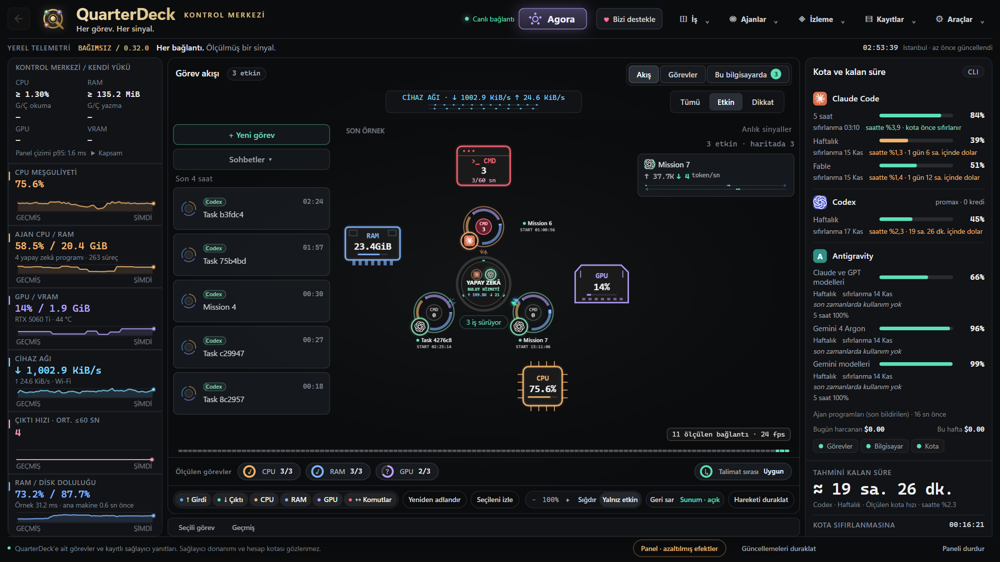

# QuarterDeck

A free Windows control room for AI coding agents. Run and watch Claude Code, Codex, Gemini CLI, Antigravity and API models from one window: every task on a live map with its own CPU, RAM and GPU use, approvals in one place, token use, and **Agora**, where several agents discuss, compare, race or build one job together.

Screenshot taken in Presentation mode, which hides task names, folders and conversations.

## Download

Open **Releases** (on the right) and pick the newest version:

- `QuarterDeck-Setup-<version>.exe`: installs for your user only, no administrator rights needed.
- `QuarterDeck-<version>-portable.zip`: no installation. Unblock the zip first (right-click → Properties → Unblock), then extract it into an empty folder.

Each release page lists the SHA-256 of its files.

## Requirements

- Windows 10 (22H2) or Windows 11, 64-bit (x64).
- Microsoft Edge WebView2 Runtime. Windows 11 already has it; on Windows 10 QuarterDeck shows the Microsoft download link if it is missing.
- At least one agent program signed in (Claude Code, Codex CLI, Gemini CLI or Antigravity CLI), or an API key for a model provider.

The program is not code-signed yet, so Windows SmartScreen may say "Windows protected your PC". Choose **More info → Run anyway**.

## Free, with gifts for supporters

QuarterDeck is free and works fully without paying. Support is one-time and any amount you choose:

- [Buy Me a Coffee](https://buymeacoffee.com/quarterdeckui)
- [GitHub Sponsors](https://github.com/sponsors/quarterdeckui)

Write your machine code (QuarterDeck → ♥ Support us) in your support note or send it to quarterdeckui@gmail.com. A gift code arrives by e-mail and unlocks the Agora modes beyond the free one.

## Privacy

QuarterDeck sends nothing to us: no account, no telemetry, no ads. Your tasks and settings stay on your computer. It checks this page for a signed `latest.json` at most once a day to tell you about updates; nothing about your computer is sent with it.

## Help

Write to **quarterdeckui@gmail.com** or open an issue here. Please include the QuarterDeck version, your Windows version and what happened. The log in `%LOCALAPPDATA%\Orchestrator\logs` helps; it hides keys and your user name.

This repository holds releases only, not source code.

---

## Türkçe

QuarterDeck, yapay zekâ kodlama ajanları için ücretsiz bir Windows kontrol odasıdır. Claude Code, Codex, Gemini CLI, Antigravity ve API modellerini tek pencereden çalıştırır ve izlersin: her görev canlı bir haritada kendi işlemci, bellek ve ekran kartı kullanımıyla görünür. Onaylar tek yerde toplanır, token kullanımı görünür. **Agora**'da birden çok ajan bir iş üzerinde konuşur, karşılaştırılır, yarışır ya da birlikte yapar.

**İndirme:** Sağdaki **Releases** bölümünden en yeni sürümü al. Kurulum dosyası yönetici izni istemez; taşınabilir zip'i önce engelini kaldırıp (sağ tık → Özellikler → Engellemeyi kaldır) boş bir klasöre çıkar.

**Gerekenler:** Windows 10 (22H2) ya da Windows 11, 64 bit; Microsoft Edge WebView2 (Windows 11'de hazır); oturumu açık en az bir ajan programı ya da bir API anahtarı. Program henüz imzalı olmadığı için SmartScreen uyarısında **Ek bilgi → Yine de çalıştır**.

**Ücretsiz, destekçilere hediye:** QuarterDeck ücretsizdir ve tam çalışır. Destek tek seferliktir, tutarı sen belirlersin: [Buy Me a Coffee](https://buymeacoffee.com/quarterdeckui) · [GitHub Sponsors](https://github.com/sponsors/quarterdeckui). Bilgisayar kodunu (QuarterDeck → ♥ Bizi destekle) destek notuna yaz ya da quarterdeckui@gmail.com adresine gönder; hediye kodu e-postayla gelir.

**Gizlilik:** QuarterDeck bize hiçbir şey göndermez; hesap, telemetri, reklam yok. Güncelleme için günde en fazla bir kez bu sayfadaki imzalı `latest.json` dosyasına bakar.

**Yardım:** quarterdeckui@gmail.com ya da buradan bir konu aç. QuarterDeck sürümünü, Windows sürümünü ve ne olduğunu yaz.

Bu depoda yalnız sürümler var, kaynak kod yok.
