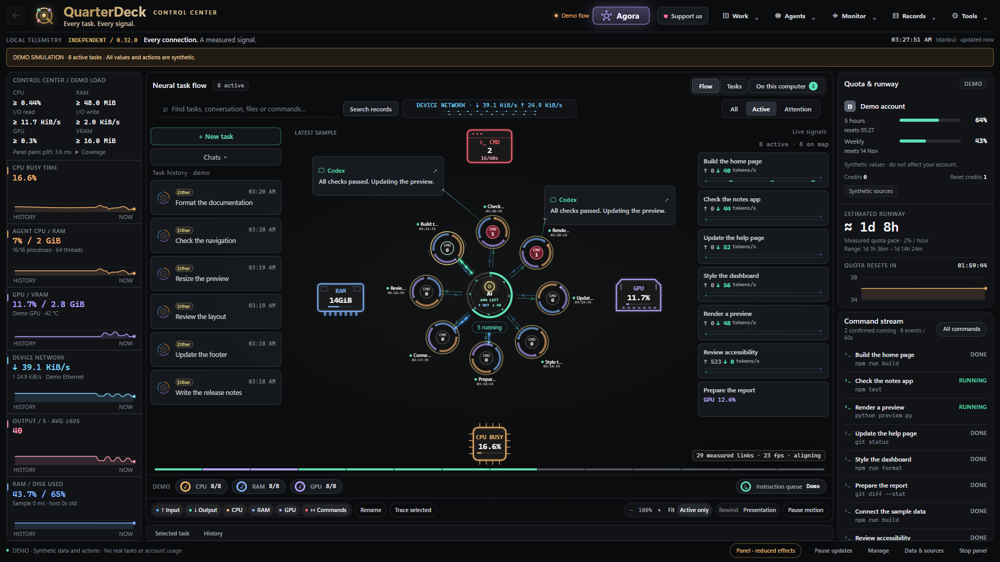
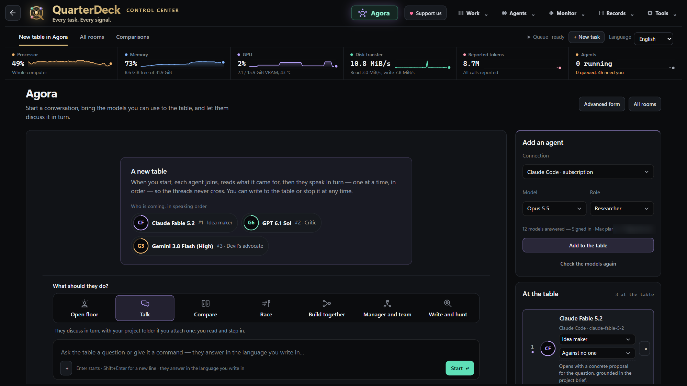

# QuarterDeck

**A free control room for your AI coding agents.** See every agent working on your computer, start and steer your own tasks, and let several models work on one question together. Everything runs on your computer; nothing is sent to us.

Home screen in Presentation mode, which hides task names, folders and conversations.

## What you get

### One live map of all your AI work
- Every task on one screen: QuarterDeck's own tasks and the work of **Claude Code, Codex (CLI and app), Gemini CLI, Antigravity and the Claude app**, each as a ring that turns faster while it works.
- **Measured, not estimated:** CPU, memory, GPU and VRAM per task, disk and network for the whole computer, and the token flow of each conversation. A value that cannot be measured shows "—", never a guess.
- **Quota and runway:** how much of each plan is left (Claude Code 5-hour and weekly windows, Codex, Antigravity), how fast you are using it, and when it would run out or reset.
- **Waiting for you:** approvals, questions and finished work that needs a look, gathered in one place.

### Your own tasks, with you in control
- Give a project folder and a goal, then choose the **connection and the exact model**: OpenAI, Anthropic, Gemini, OpenAI-compatible endpoints such as Ollama or LM Studio, or the agent programs already signed in on your computer (Claude Code, Codex CLI, Gemini CLI, Antigravity CLI, Aider). No automatic switching.
- The agent asks before it **writes files or runs commands**; trust it fully only when you choose to.
- Attach images, PDFs and text files; follow the conversation, the code and the output side by side.
- **Take over** a conversation you started in Claude Code or Codex and continue it here.
- Work in a separate git copy and preview the diff before it merges; branch a conversation to try another model; schedule tasks once or on a repeat; keep project notes the agent remembers.

### Agora: several models at one table
- **Open floor** (free for everyone): the models discuss an idea in turn while you read and step in.
- **Talk** with your project folder, **Compare** answers side by side (blind if you like), **Race** the same task in separate copies and merge the winner, **Build together**, **Manager and team**, and **Write and hunt** (one writes, one reviews).
- Give each seat a role (idea maker, critic, researcher, builder, devil's advocate, tester…); agents can ask for evidence from your files, and a claim map shows which arguments are still standing. Turn the conclusion into a task.

### And more
- **Resource care:** finds helper processes that AI apps left behind (MCP servers, code runners) and can release them.
- **Records:** token audit, recorded history, checkpoints and file recovery.
- **Tool servers (MCP)** with approval per call, or trust per server or per tool.
- **Phone view:** a read-only view on your phone over your Wi-Fi, with approve/deny in two taps.
- **Presentation mode** hides names, folders and conversations for screenshots and demos.
- **10 languages:** English, Turkish, German, Spanish, French, Italian, Japanese, Portuguese, Russian and Chinese. Dark and light themes.

## Download

Open **[Releases](https://github.com/quarterdeckui/quarterdeck-releases/releases/latest)** and pick the newest version.

**Windows 10 (22H2) or Windows 11, 64-bit**
- `QuarterDeck-Setup-<version>.exe`: installs for your user only, no administrator rights needed.
- `QuarterDeck-<version>-portable.zip`: no installation. Unblock the zip first (right-click → Properties → Unblock), then extract it into an empty folder.
- The program is not code-signed yet, so SmartScreen may say "Windows protected your PC". Choose **More info → Run anyway**.
- Needs Microsoft Edge WebView2, which Windows 11 already has; on Windows 10 QuarterDeck shows Microsoft's download link if it is missing.

**macOS and Linux** packages are added to the release page as soon as their builds finish testing.

Each release page lists the SHA-256 of its files. You also need at least one agent program signed in (Claude Code, Codex CLI, Gemini CLI or Antigravity CLI) or an API key for a model provider.

## Free, with gifts for supporters

QuarterDeck is free and works fully without paying. Support is one-time and any amount you choose:

- [Buy Me a Coffee](https://buymeacoffee.com/quarterdeckui)
- [GitHub Sponsors](https://github.com/sponsors/quarterdeckui)

Write your machine code (QuarterDeck → ♥ Support us) in your support note or send it to quarterdeckui@gmail.com. A gift code arrives by e-mail and opens the Agora modes beyond the Open floor.

## Privacy

QuarterDeck sends nothing to us: no account, no telemetry, no ads. Your tasks, keys and settings stay on your computer; API keys go to the operating system's protected store (Windows DPAPI, macOS Keychain, the Linux Secret Service where available). Your prompts go only to the model provider you choose. Once a day at most it reads a signed `latest.json` from this page to tell you about a new version; it never downloads or installs anything by itself.

## Help

Write to **quarterdeckui@gmail.com** or open an issue here. Please include the QuarterDeck version, your operating system and what happened. The log in `%LOCALAPPDATA%\Orchestrator\logs` (Windows) helps; it hides keys and your user name.

This repository holds releases only, not source code.
